<div align="center">

# 🍽️ DineMaster

**Full-stack restaurant & event-venue booking platform for Uzbekistan**

Real-time table availability · online deposits (Payme / Click) · staff roles · reports · Telegram notifications · 3 languages

[](https://github.com/Shamshodbek11/dinemaster-restaurant-booking/actions/workflows/ci.yml)


🇺🇿 [O'zbekcha to'liq qo'llanma](docs/SETUP.uz.md) · 📝 [Changelog](CHANGES.md)

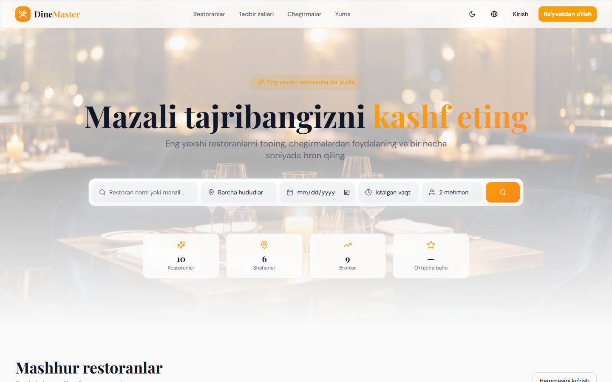

</div>

---

## Overview

DineMaster lets guests discover restaurants and banquet halls, see **live availability** for a date, time and party size, and book in **two steps** — with optional table choice and dish pre-ordering. Restaurants get a full back office: bookings, calendar, tables, menu, waitlist, discounts, staff accounts and PDF reports. A platform superadmin moderates restaurants, payments and content.

The UI is fully translated into **Uzbek, Russian and English**, works on phones, and supports light / dark / system themes.

## Screenshots

| Booking — step 1 (time, table) | Booking — step 2 (review & policy) |
|---|---|
| 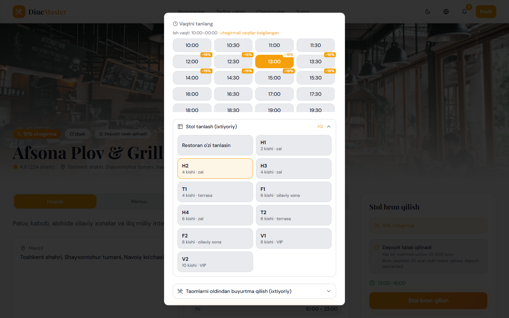 | 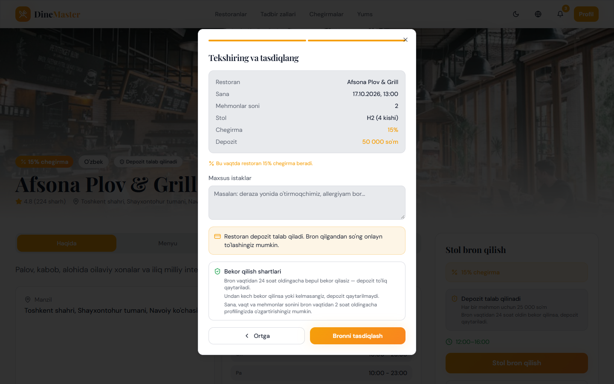 |
| **Restaurant dashboard — bookings & table assignment** | **Monthly calendar** |
| 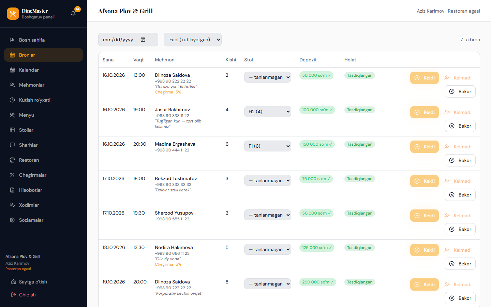 | 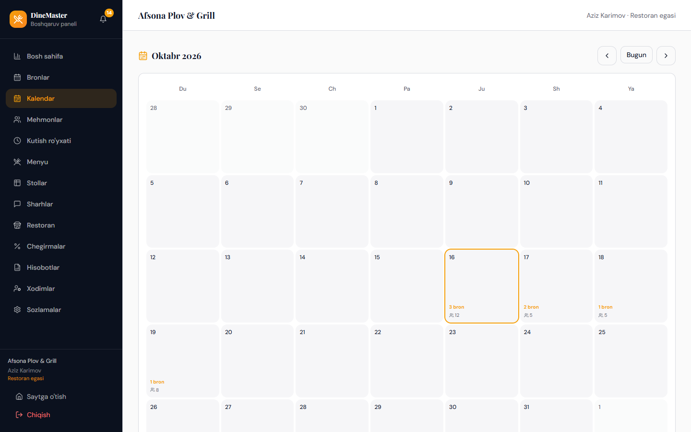 |
| **Superadmin — moderation** | **Superadmin — payments & refunds** |
| 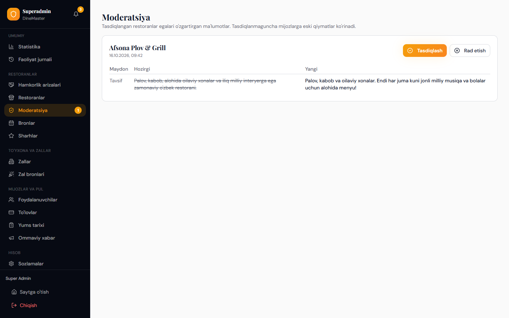 | 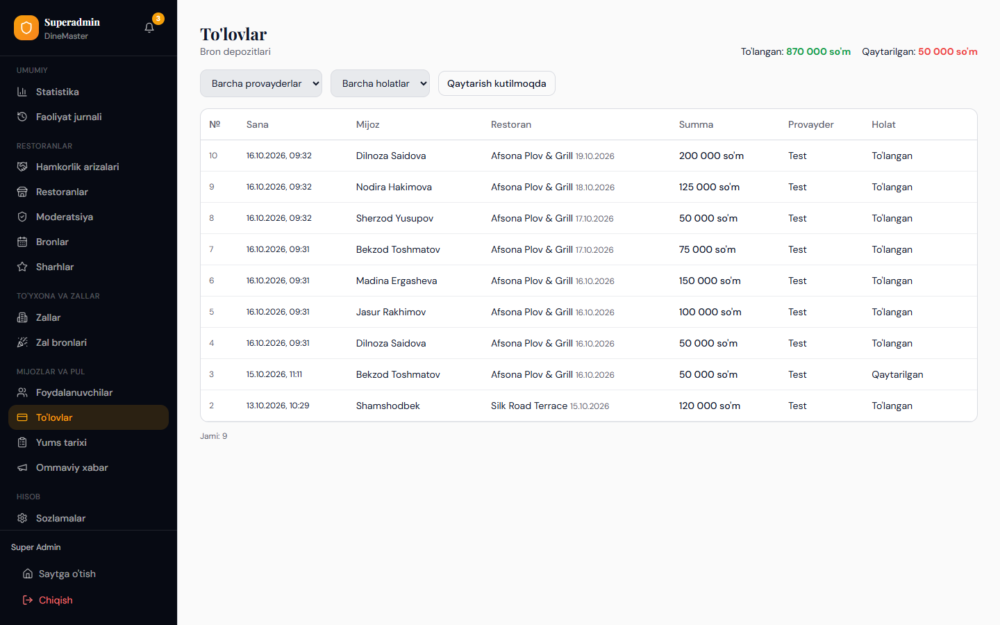 |

<p align="center">
  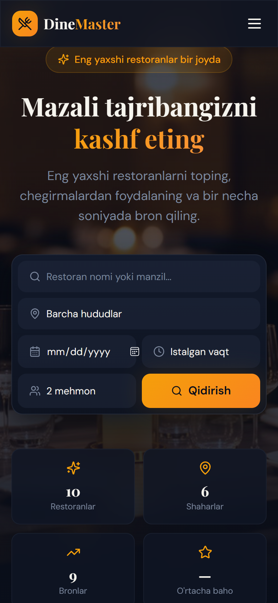
  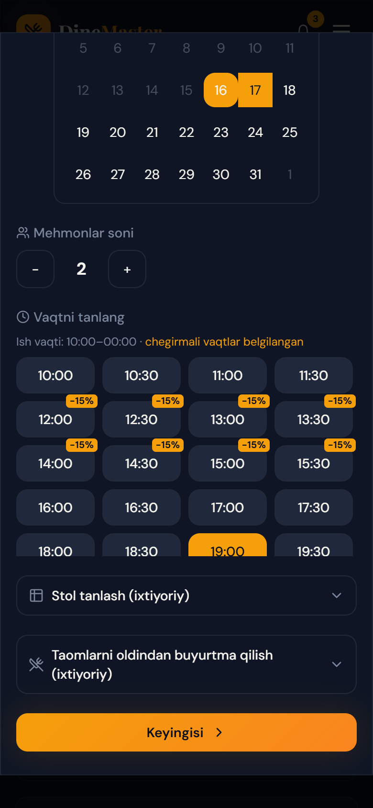
  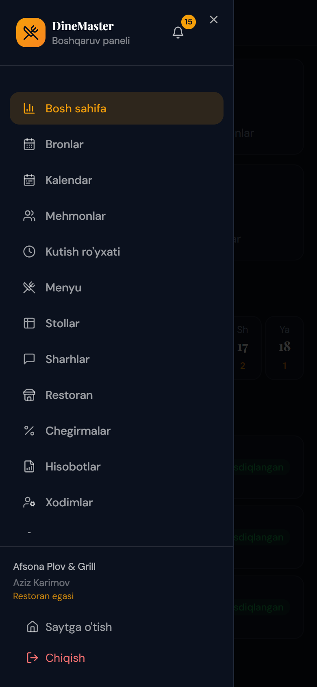
  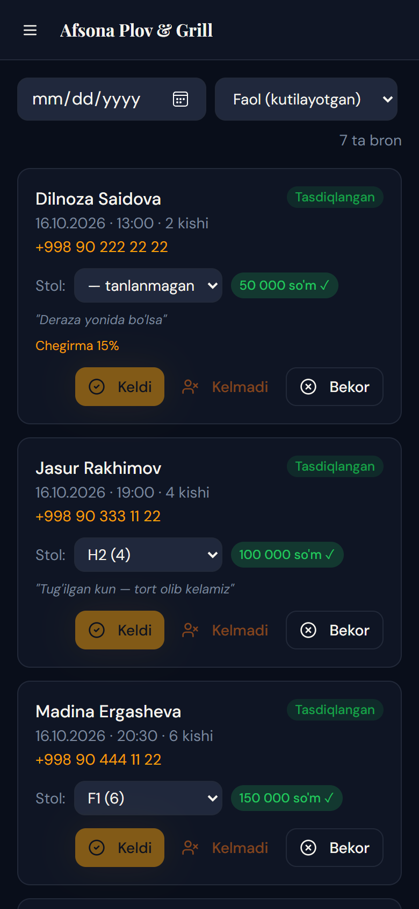
</p>

More in [`docs/screenshots`](docs/screenshots).

## Features

### For guests
- Search by name, region, **date + time + party size** — only restaurants with a free table are shown
- 2-step booking: time slots from opening hours, holiday closures and capacity; discounted slots highlighted
- Optional table selection and dish pre-order
- Online deposit via **Payme** or **Click**; clear cancellation policy (free up to 24 h before)
- Change or cancel a booking from the profile; refunds tracked end-to-end
- **Yums** loyalty points for completed visits and a real **referral program**
- Waitlist, favourites, reviews with owner replies
- Email verification codes, in-app and **Telegram** notifications

### For restaurants
- Dashboard with today's bookings, weekly strip and monthly calendar
- Check-in / no-show, cancel with a reason (guest is notified), assign tables with conflict detection
- Menu builder, tables, opening hours, **special days** (holidays, closures), time-based discounts
- **Staff accounts**: owner · manager · host with different permissions
- Daily / weekly / monthly / yearly reports with **PDF export**
- Event-venue requests (weddings, banquets) for hall owners

### For the platform
- Partner applications → restaurant owner onboarding
- Moderation of name / description / address / photo changes
- Payments with refund queue, users, reviews, activity log, broadcast messages
- Branding in one place (`VITE_BRAND_NAME` / `Branding:Name`)

## Tech stack

| Layer | Technologies |
|---|---|
| Backend | ASP.NET Core 10 Web API, Entity Framework Core 10, Npgsql, JWT auth, rate limiting, QuestPDF, MailKit |
| Database | PostgreSQL 15+ (migrations applied automatically on start) |
| Frontend | React 18, TypeScript, Vite, Tailwind CSS, shadcn/ui (Radix), Framer Motion, Recharts |
| Payments | Payme Merchant API, Click SHOP API, local test provider |
| Notifications | In-app, SMTP email, Telegram Bot API (long polling) |
| Testing | xUnit + `WebApplicationFactory` against a real PostgreSQL database · Vitest |
| CI | GitHub Actions — backend build & tests with a PostgreSQL service, frontend lint / type-check / tests / build |

## Architecture

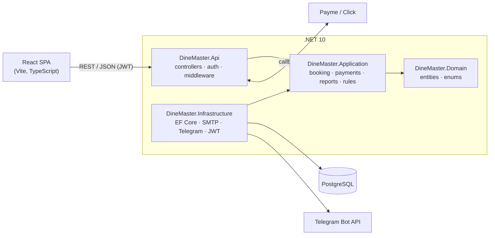

Business rules live in the Application layer (`BookingService`, `PaymentService`, `ReportService`, `OpeningHours`); controllers stay thin. Bookings are created inside **serializable transactions** so two guests can never take the same slot or table.

```
backend/
  DineMaster.Api/             # Web API, controllers, auth, startup
  DineMaster.Application/     # Services, DTOs, business rules
  DineMaster.Domain/          # Entities and enums
  DineMaster.Infrastructure/  # EF Core DbContext, migrations, email, Telegram
  DineMaster.Tests/           # Unit + integration tests (real PostgreSQL)
frontend/                     # React + Vite SPA
scripts/                      # Database creation and local secrets setup
docs/                         # Uzbek setup guide, screenshots
```

## Getting started

**Requirements:** .NET 10 SDK · Node.js 20+ · PostgreSQL 15+

```bash
# 1. Database
psql -U postgres -f scripts/create-database.sql

# 2. Local secrets (connection string, JWT key, optional SMTP / Telegram) — Windows PowerShell
./scripts/setup-dev-secrets.ps1

# 3. Backend — http://localhost:5000 (migrations and demo data are applied automatically)
cd backend/DineMaster.Api
dotnet run

# 4. Frontend — http://localhost:8080 (proxies /api to the backend)
cd frontend
npm install
npm run dev
```

On macOS / Linux set the same values with `dotnet user-secrets` — see the [setup guide](docs/SETUP.uz.md#2-backend-sozlamalari-maxfiy-qiymatlar).

Secrets are never committed: they are stored in .NET user-secrets (development) or environment variables (production).

### Demo accounts (Development only)

The database seeder runs only in the `Development` environment and creates demo data:

| Role | Email | Password |
|---|---|---|
| Superadmin | `super@dinemaster.uz` | `DM@Super2025!` |
| Restaurant owner | `admin1@dinemaster.uz` … `admin10@dinemaster.uz` | `DM@Admin2025!` |
| Guest | `user@dinemaster.uz` | `DM@User2025!` |

> These accounts exist only in local development databases. Never run a production instance with `ASPNETCORE_ENVIRONMENT=Development`.

## Tests

```bash
# Backend: 56 tests (unit + integration). Uses a separate "<db>_test" database.
cd backend
dotnet test

# Frontend: lint, type-check, unit tests (incl. translation coverage), build
cd frontend
npm run lint
npx tsc -p tsconfig.app.json --noEmit
npm test
npm run build
```

Integration tests run the whole API in memory against PostgreSQL: booking races, deposits and refunds, Payme / Click protocols, staff permissions, special days, referral rewards and more. Set `DINEMASTER_TEST_DB` to a connection string, or the tests read the API's user-secrets.

## Configuration

| Setting | Purpose |
|---|---|
| `ConnectionStrings:DefaultConnection` | PostgreSQL connection |
| `Jwt:Secret` | Token signing key (auto-generated in development) |
| `Email:*` | SMTP for verification codes |
| `Payments:Payme:*`, `Payments:Click:*` | Payment provider credentials |
| `Telegram:BotToken`, `Telegram:BotUsername` | Optional Telegram notifications |
| `Booking:*` | Cancellation window, deposits, discounts, referral bonus, booking horizon |
| `Branding:Name` / `VITE_BRAND_NAME` | Product name in emails, PDFs and UI |

Full reference (in Uzbek): [docs/SETUP.uz.md](docs/SETUP.uz.md).

## Author

**Shamshodbek** — [github.com/Shamshodbek11](https://github.com/Shamshodbek11)

## License

Copyright © 2026 Shamshodbek. **All rights reserved.** The source code is published for viewing and evaluation only — see [LICENSE](LICENSE).
